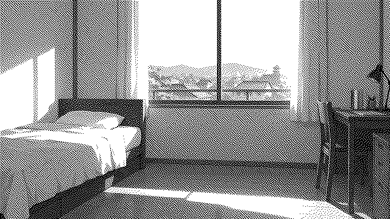
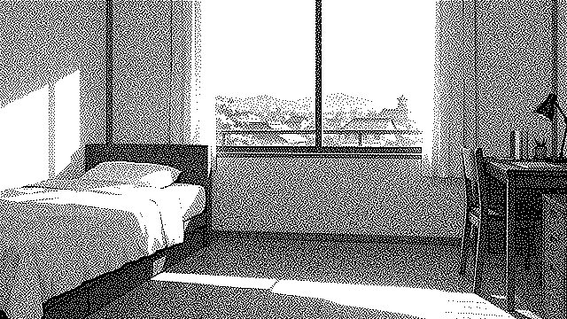

# miwast: Miwa no Utsuroi on the Atari STE

A ren'py-compatible engine capable enough to port my *Miwa no Utsuroi* kinetic novel to the Atari STE.

Hence the name: *miwast*.

It runs in monochrome high resolution (640x400) on a 2MB machine with a hard
disk, and plays the original soundtrack through the STE's DMA sound.

It can be used to port other (simple enough) ren'py games to the STE.

This is not an emulator or interpreter of Ren'Py. A compiler on the host
reads the game's `.rpy` scripts and turns them into a small bytecode, plus
images and sounds in formats the ST can use as they are. A C engine on the
ST plays that bytecode back. It follows Ren'Py 8.5.3's behaviour closely:
rollback and rollforward, skip, saves, language switching, transitions,
menus and persistent data.

The comments in the code cite the Ren'Py source file and line each behaviour comes from.

## What is in here

| path | what |
|---|---|
| `src/` | the ST engine (C89 and 68000 assembly): VM, graphics, music, menus, the rhythm mini-game |
| `tools/` | host tools: the script compiler (`mwc`), image converter (`mwimg`), packer (`mwpak`), dump tool (`mwdump`), dithering scripts, Hatari test drivers |
| `tools/rpy/` | the Ren'Py parser, taken from the minirenpy C89 engine (DOS/Win32s) |
| `tools/fixtures/` | test scripts: every branching form the compiler accepts, and the backdrop cases |
| `audioconv/` | the converter that turned the game's music into the SNDH files the ST plays (see below) |
| `miwa_stub/` | `MIWALDR.PRG`, an AUTO-folder loader that starts the game before GEM |
| `deps/libcmini/` | the small C library the ST program links against |
| `emu/` | the Hatari configuration used by the test scripts |
| `beatgen/` | the beatmap generator used for the rhythm minigame |
| `NOTES.md` | the developer's log: formats, design decisions, measurements, bugs and why they are fixed the way they are |

### audioconv

`audioconv/` holds the converter used for the game's music. It turns any
audio file into an SNDH file that plays the recording itself through the
STE's DMA sound: 8-bit mono at 12517 Hz, compressed as 4-bit ADPCM (or as
lossless Rice codes), and decoded on the fly by a small position-independent
68000 replay routine. That routine is called 50 times a second and keeps a
4KB DMA ring buffer filled.

The game uses the ADPCM conversions (`.snd` beside each original in `game/audio/`).

See `audioconv/README.md` for its usage and requirements.

## Building

Requirements:

- a host C compiler (`gcc`)
- `m68k-atari-mintelf-gcc` (the cross compiler) and `vasmm68k_mot`
  (assembler, Motorola syntax)
- ImageMagick (`convert`) and `ffmpeg`, only to make missing art (`make
  images`)
- Hatari, only for the test scripts

```
make            script → images → data → pak (dist/MIWA.PAK)
make st         + dist/st/MIWA.PRG beside a copy of the pak: what goes on the disk
make check      compile the test fixtures; the compiler plays every path
make clean      never removes art/
```

| step | what | output |
|---|---|---|
| `make script` | `tools/mwc` parses `game/*.rpy` and compiles them, following execution order | `dist/SCRIPT.MWB`, `dist/TEXT_FR.MWT`, `dist/TEXT_EN.MWT`, `dist/manifest.txt`, `dist/script.dump` |
| `make images` | `tools/mkart.sh`: each image the script uses, Atkinson-dithered to black and white, sprites with a 1px black outline inside and a 1px white one outside | `art/bg`, `art/sprite`. Only missing files are made; `REDO="name"` overwrites named ones |
| `make data` | `tools/mwimg`: art → `.MBG` (backdrops) and `.MSP` (sprites); flips are applied here | `dist/data/` |
| `make pak` | `tools/mwpak`: script, text, images, music and beatmaps in one file | `dist/MIWA.PAK` |

`art/` is source, not build output: the dithered images were retouched by
hand (mouths, eyes, details), and the build never overwrites them. To try
other dithers without touching `art/`, see [Dithering](#dithering).

`make` takes `BUILD=` and `DIST=` to build somewhere else. Test variants of
the ST program (most only work under Hatari: NatFeats crash a real machine):

| variable | effect |
|---|---|
| `NATFEATS=1` | traces to the host through Hatari's NatFeats |
| `AUTOPLAY=1` | plays itself to the end, every transition included |
| `ANSWERS=1,0,2` | what autoplay answers the menus it meets |
| `STOPAT=<offset>` | gives control back to the keyboard at that offset (from `dist/script.dump`) |
| `STLANG=1` | starts in English when there is no `MIWA.SAV` |
| `SLOW=<n>` | transitions n times slower, for screenshots |
| `SPRBUDGET=<bytes>` | a smaller sprite arena, as on a machine with less free memory |
| `SELFTEST=1` | blitter sprites checked against a CPU reference, then a dissolve stress test |
| `RHYTHMTEST=<n>` | a rhythm-game timing test (`src/rtest.c`) instead of the game |
| `RHYTHMBOT=1` | the rhythm game plays itself, every note hit |

`tools/check-st.sh <lang> <answers>` plays the branching fixture on the ST
under Hatari with those menu answers, and diffs its trace against the
compiler's own walk of the same path.

### Installing

Copy `dist/st/MIWA.PRG` and `MIWA.PAK` into `\MIWA\` on the hard disk.

On a 2MB STE there is not enough memory with the GEM desktop loaded: put
`miwa_stub`'s `MIWALDR.PRG` in `\AUTO\`. It starts `\MIWA\MIWA.PRG` before
GEM and resets the machine when the game quits.

With more memory, the game can also be started from the desktop (Works on my STE with 1.8MB free at startup).

Saves (`MIWA.SAV`, `MIWAnn.LOG`) and persistent data (`MIWA.PER`) are written beside the program.

## Dithering

Every picture has to become pure black and white. `make images` uses
ffmpeg's Atkinson dither (`paletteuse=dither=atkinson`), which keeps good
contrast and clean whites. On flat mid-tones, though, it falls into short
cycles that show as regular diagonal stripes and herringbone patterns: on
walls, floors and skies, the pattern is more visible than the picture.

`tools/gdither.c` is our own error-diffusion ditherer, written to fix that
while keeping Atkinson's look:

- **Same tones as ffmpeg's Atkinson.** It works in colour as `paletteuse`
  does: the error is spread over R, G and B separately, and black or white
  is chosen by OkLab lightness. With `-i`, each neighbour's share of the
  error is an integer, as in ffmpeg, so small errors near white are
  dropped and light areas stay clean. On a test image, the share of white
  pixels matches ffmpeg's within 0.1%.
- **Serpentine scanning** (odd rows right to left, with the kernel
  mirrored) removes the one-way push that picks the diagonal.
- **Threshold jitter** (`-n 48`) breaks the cycles that remain. It is
  strongest at mid-grey and fades quickly towards black and white (`-f 3`),
  so light areas don't pick up dark specks. It is applied only where the
  image is flat (`-c 16`, fading with the local gradient), so edges, lines
  and small shapes stay as crisp as plain Atkinson.
- **Less error passed on** (`-k 0.65` instead of Atkinson's 0.75): more
  contrast, cleaner whites, denser darks.
- **An unsharp mask before dithering** (`-u 0.7`), so outlines and small
  details read better at half scale.

It also has a Jarvis-Judice-Ninke kernel and an experimental
gradient-steered mode (`-s`); neither is used for the game.

| Atkinson (ffmpeg, `make images`) | gdither (`-K atkinson -k 0.65 -i -n 48 -f 3 -c 16 -u 0.7`) |
|---|---|
|  |  |

The scripts:

| script | what |
|---|---|
| `tools/gdither.sh <in> <out.png> [border]` | one image through gdither with the settings above, at its own size (scale a backdrop to 640x360 first); `border` adds the sprite outlines |
| `tools/mksprite.sh <image> <out.png>` | one sprite from the full-size original: halved as the compiler expects, dithered with gdither (`GDITHER="<options>"` for others), alpha made all-or-nothing, and `mkart.sh`'s outlines added |
| `tools/jarvisdither.sh <image> <dir>` | one image dithered every way tried (plain Atkinson, each gdither step above, Jarvis, steered), to compare them side by side |

`gdither` is built with `make tools/gdither` (`mksprite.sh` and
`jarvisdither.sh` do it themselves; run it once before `gdither.sh`). None
of the scripts writes into `art/`: the chosen result is copied over the art
file by hand.

## The supported Ren'Py subset

The compiler supports what this game uses, and stops with an error on
anything else rather than guessing.

Statements:
- `label`, `jump`, `call` / `return` (followed in line by the compiler)
- `menu` with captions and conditional options (`if`), at most 12 options
- `if` / `elif` / `else`
- `scene`, `show` (with `at left/center/right`, `behind`, attributes, and
  placements:
  `xalign`, `xpos`, `ypos`, `xanchor`, `yanchor`, `xoffset`, `yoffset`), `hide`
- `with`: `None`, `dissolve`, `fade`, `Fade(out, hold, in)`, `move`,
  `moveinleft`, `moveinright`, `moveoutleft`, `moveoutright`
- `play music` / `stop music` (`loop`, `if_changed`); sound effects are
  dropped
- `window show` / `window hide`
- `pause` and `renpy.pause(t, hard=True)`
- say statements, by named characters and `centered`
- `define` / `default` / `persistent.` variables
- `show screen title` / `hide screen title` (the game's chapter cards)
- `call screen rhythm_game(...)` (the mini-game, see below)
- one ATL form: a single `linear` step (the credits roll)

Expressions and Python: `$ var = expr` with None, booleans, 32-bit integers
and strings; `and`/`or`/`not` (returning an operand, as in Python),
comparisons and arithmetic. Also a fixed set of idioms:
`renpy.block_rollback()`, `config.rollback_enabled`, `_skipping`,
`renpy.music.play(...)`, `_preferences.language` tests, and the rhythm
game's `a, b, c = _return`. Calls with no effect on the ST
(`renpy.save_persistent()`, `renpy.checkpoint()`, volume and mute) are
accepted and ignored.

Text: `{i}`, `{b}`, `{fast}`, `[var]` substitution, and `[title!t]`.
Translations come from `tl/<language>/` (French original, English).

Not supported: alpha, zoom and rotation, general ATL,
screen language beyond the two screens above, `queue music`, sound channels, and arbitrary Python.

## How the engine works

### The compiler (`tools/mwc.c`)

`mwc` parses the scripts with the minirenpy C89 parser, then **walks them in
execution order**, simulating Ren'Py's scene list as it goes: tags,
attributes, `behind`, placement and the `default` transform. Every position
is therefore final pixels by the time it reaches the ST: the bytecode says
"draw sprite 12 at (210, 40), z 2", never "show eileen happy at left".

The walk's display state (backdrop, sprites and their positions, music,
window, title card, skip and rollback flags) is recorded with each statement
it compiles. A branch that comes back to a statement with the same state
emits a `GOTO` there; one with a different state compiles a copy until the
states agree again (usually at the next `scene`). As a result, **the display
state is a function of the code position**. That is what lets the ST do
rollback by replay (below).

Each build ends with a path check. Every sequence of menu answers, in both
languages, is played twice: once through the compiled code as the ST runs
it, and once down the source with the minirenpy expression evaluator. The
two must agree at every line, and every command must be reached with a
single display state.

The output:
- `SCRIPT.MWB`: a stream of 16-bit commands, plus tables (images, music,
  variables, expressions in RPN, menu options, keyframe hints)
- one `.MWT` text file per language: lines pre-wrapped for the 78x4 text box,
  in the Atari character set, with inline style codes
- beatmaps (`.BTM`) for the rhythm game, read from the Ren'Py beatmaps at
  build time. Their header also holds the pitch of each song's four hit
  sounds, measured from its WAV files by autocorrelation (YIN).

Images are stored uncompressed: a backdrop is one 28,800-byte screen copy,
and a sprite a mask plane plus a data plane. Reading from the hard disk is
faster than decompressing on an 8MHz 68000.

### The VM (`src/vm.c`)

The ST runs the commands up to each interaction: a line of dialogue, a menu,
a pause or a transition. Each command updates a stage state (backdrop plus
sprite slots), which is drawn and shown when the frame is due.

- **Rollback is a replay.** Since the display depends only on position,
  rolling back means resetting, then running the commands up to the
  target checkpoint without drawing, waiting or loading anything. Keyframes
  (a saved state at each branch target and every 64th checkpoint) keep this
  to a few milliseconds. A rollback log, as in Ren'Py's `RollbackLog`, holds
  the variables and menu answers of the last 128 checkpoints. Rolling
  forward re-runs the game live with the same answers, as
  `roll_forward_core` does.
- **Saves** store the checkpoint, the rollback log (future included) and a
  160x90 thumbnail. They survive rebuilds that only change staging:
  positions, transitions, music, art and translations.
- **Skip** (Ctrl), the **game menu** (Esc or right click: save, load, text
  speed, language, restart, quit), the **typewriter** at the player's text
  speed, and **language switching** at any line all follow Ren'Py's
  behaviour, which the comments cite.
- **Sprites** live in one memory arena taken at start, loaded from the pak
  on demand, dropped least-recently-used first, and compacted when a gap is
  too small. The music shares the block: the tune sits at its top, and the
  sprites get whatever the current tune leaves.

### Graphics (`src/gfx.c`)

The screen is 640x400 monochrome: a 640x360 stage (Ren'Py's 1280x720 at
half scale) and a 40-line text box below it. Text uses TOS's own 8x8 font
through Line-A, which covers every French letter. Italic and bold are
derived from it.

**Two screens, swapped at the VBL.** The vertical blank interrupt comes 71
times a second in monochrome. The engine always draws into the hidden screen
and then swaps (`gfx_flip`: `Setscreen`, then `Vsync`). The rhythm game uses
`gfx_flip_poll` instead. It writes the screen base registers itself, so the
new screen is shown at the very next frame rather than one later. It then
reads the video counter to check that the switch actually happened, and
waits another frame if it was too late.

**The blitter does all the large work:**
- a backdrop is one full-stage copy
- a sprite is two passes: the mask clears its shape (`NOT S AND D`), then
  the data is ORed in (`S OR D`). Unaligned positions use the blitter's skew
  with FXSR/NFSR and end masks.
- dissolve and fade compute the difference between the old and new screens
  once (XOR). Each step then XORs in the pixels whose 16x16 Bayer threshold
  the elapsed time has passed, using the blitter's halftone RAM as the
  pattern. The effect is a dithered crossfade whose progress follows the
  clock, so a slow step is followed by a bigger one.
- moves recompose the whole stage every frame (about 40ms per frame), with
  each sprite at the position interpolated for the elapsed time.

**Hog mode, in short chunks.** The blitter runs in hog mode, which stops
the CPU for the whole blit. Each blit is split into chunks of at most 128
words (about 3 stage lines, under 0.5ms). Interrupts are served between
chunks, and the blitter's address and halftone line registers carry on from
where they stopped. Why not the alternatives:
- *Shared mode* (the blitter and CPU take turns, restarted with Atari's
  `bset #7` loop) gave wrong results partway down the screen under Hatari.
  It happened when a long interrupt (the music's ADPCM decoder, several
  milliseconds per call) landed in the middle of a blit. A stress test of
  300 dissolves into a buffer found the problem in 96 of 150 runs with music,
  and none with hog chunks.
- *Long hog blits* block interrupts for too long. The keyboard processor
  sends a byte every 1.28ms and the ACIA holds only one, so a mouse packet
  arriving during a long chunk loses a byte. TOS then read the packet's
  movement byte as a keypress: a 1-pixel move right became scancode 1, Esc,
  and opened the game menu. A whole-stage blit in one go would also hold off
  the 200Hz Timer C (the clock and the music) for about 36ms.

The rule throughout the engine: **nothing holds interrupts off for longer
than about 1ms.**

### Mouse and pointer (`src/mouse.s`, `src/gfx.c`)

Started from the AUTO folder there is no GEM, so no VDI mouse handler. The
engine installs its own on the IKBD mouse vector. It tracks position and
buttons, and passes every packet on to whatever handler was there before,
so it works under GEM too. The pointer is drawn by a routine in TOS's VBL
queue, which saves and restores the pixels under it separately for each of
the two screens.

### Music and sound (`src/music.c`)

The music is SNDH, played by gwEm's Timer C player (`sndh.c`,
`sndhisr.s`, LGPL, adapted for the mintelf toolchain, unchanged from STVN).

Each tune is one of the `audioconv` DMA conversions.

Decoding takes about 31% of the CPU at 8MHz.

A tune is always stopped before another is loaded.
For the rhythm game, the engine can also pause the tune (Timer C handed back to TOS,
the DMA stopped where it was) and resume it exactly where it stopped.

The rhythm game's hit sounds use the YM2149, which the STE mixes with the
DMA output: a square wave at each song's hit pitch, on the three channels in
turn. A VBL hook makes it decay over about 0.28s.

### The rhythm game (`src/rhythm.c`)

A port of the game's Ren'Py rhythm mini-game (`game/00-renpythm`), reached
by `call screen rhythm_game(...)`. Notes are timed against the music's start
to the millisecond, and keys are read while waiting for the VBL, not once per
frame. To reach 32-35 frames per second, it redraws only the rectangles
around the notes over a pre-drawn layer of backdrop and tracks. The score
display is drawn by the CPU in the text box, and only when it changes.
Scores and high scores are 32-bit and kept in the persistent file.

## Testing

`tools/hatari.sh` and `tools/drive.sh` run Hatari with a clean
configuration (`emu/`: 2MB STE, TOS 2.06, mono). `drive.sh` reads a small
command language: wait, keys, screenshots, sound recording, and waiting for
a line in the game's NatFeats trace. `FAST=1` runs the CPU at 32MHz with
fast-forward, for runs that check behaviour; timings are only meaningful at
8MHz. See `NOTES.md` ("Hatari") for the details and pitfalls.

## Licences

- **The engine, the tools and `audioconv/`: MIT** (`LICENSE`). That includes
  the Ren'Py parser in `tools/rpy/`, from the minirenpy C89 engine.
- **The SNDH player library** (`src/sndh.c`, `src/sndh.h`, `src/sndhisr.s`)
  by Simon Sunnyboy / Paradize, from gwEm's original code: **LGPL 2.1**
  (`COPYING.LGPL`).
- **libcmini** (`deps/libcmini/`): **LGPL 2.1** (its `LICENSE.txt`).

`MIWA.PRG` links the LGPL parts statically. This source release, with its
Makefile, is what lets you rebuild it with a modified version of them, as
LGPL 2.1 section 6 requires: keep a pointer to it next to any binary you
distribute.

The engine reproduces the behaviour of Ren'Py 8.5.3 (MIT), and the comments
cite the Ren'Py source they follow.
